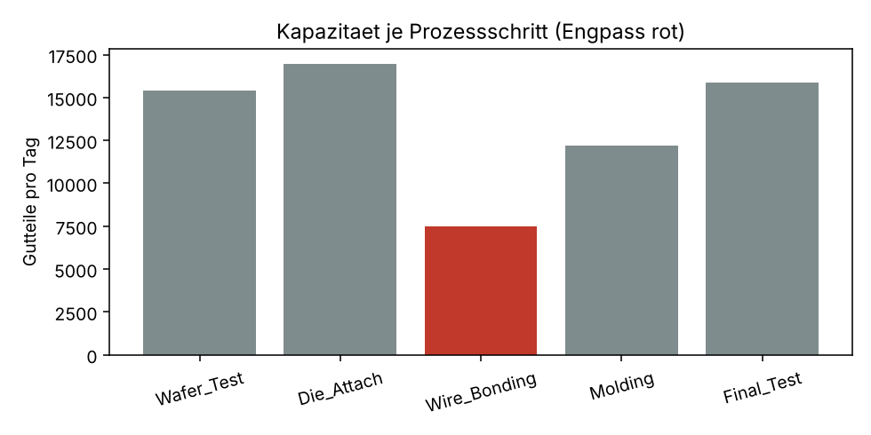

# Manufacturing Bottleneck Analytics

Engpass- und OEE-Analyse für eine Halbleiter-Back-End-Linie
(Wafer Test → Die Attach → Wire Bonding → Molding → Final Test)
mit **SQL**, **Python** und **Tableau**.

> Die Daten sind **synthetisch** erzeugt (12 Wochen, 3 Schichten,
> 12 Anlagen, ca. 7.400 Stillstandsereignisse). Es werden keine echten
> Unternehmensdaten verwendet.

## Fragestellung

Welcher Prozessschritt begrenzt den Output der Linie, warum, und welche
Maßnahmen bringen am meisten?

## Ergebnis (Kurzfassung)

- **Engpass: Wire Bonding**, ca. 7.500 Gutteile/Tag. Der nächste
  Schritt (Molding) schafft ca. 12.200/Tag.
- Verfügbarkeit am Engpass sinkt über 12 Wochen von ca. 83 % auf 80 %.
- **Rüsten** und **mechanische Störungen** verursachen ca. 51 % der
  Stillstandszeit (Pareto).
- Ausschuss am Engpass ist in der Nachtschicht am höchsten.
- Empfehlungen: SMED am Engpass, vorbeugende Wartung, Ursachenanalyse
  Nachtschicht, Puffer vor dem Engpass.

Vollständiger Bericht: [`report/management_summary.md`](report/management_summary.md)



## Aufbau

```
src/generate_data.py   erzeugt die synthetischen Produktionsdaten (CSV)
sql/schema.sql         Datenbankschema (SQLite)
sql/analysis.sql       SQL-Analysen: OEE, Kapazität, Pareto, Ausschuss, Trend
src/pipeline.py        lädt Daten, prüft Datenqualität, führt SQL aus,
                       exportiert Tableau-Datensätze, schreibt den Bericht
tableau/               CSV-Datensätze + Anleitung für das Dashboard
report/                Management Summary + Diagramme
```

## Ausführen

```bash
pip install pandas matplotlib tabulate
python src/generate_data.py
python src/pipeline.py
```

## Methodik

- **OEE** = Verfügbarkeit × Leistung × Qualität, je Anlage
- **Engpass** = Prozessschritt mit den wenigsten Gutteilen pro Tag
- **Pareto** der Stillstandsgründe mit kumuliertem Anteil (Window Function)
- **Datenqualitätsprüfungen** vor der Analyse (z. B. Stillstand >
  Planzeit, Ausschuss > Gesamtmenge, Summenabgleich Ereignisse vs. Schicht)

## Werkzeuge

SQL (SQLite, CTEs, Window Functions), Python (pandas, matplotlib),
Tableau Public. Entwickelt mit Unterstützung von GitHub Copilot und
ChatGPT/Claude.

## Grenzen

Synthetische Daten bilden reale Effekte (Verschleiß, Schichteinfluss,
Materialfluss, WIP-Puffer) nur vereinfacht ab. Leistung wird pro Schicht
aggregiert, nicht pro Einzelzyklus.
