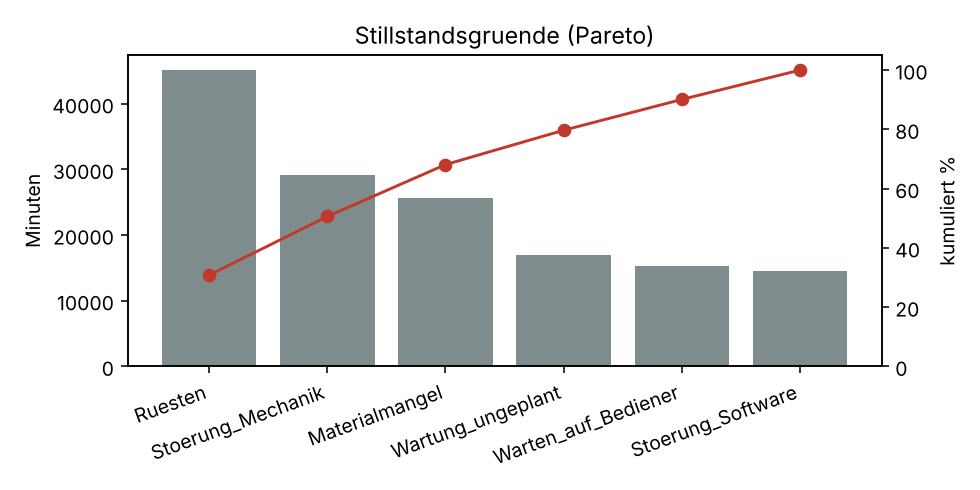

# Management Summary – Engpassanalyse Back-End-Linie

*Synthetische Daten, 12 Wochen, 5 Prozessschritte, 12 Anlagen.*

## Kernaussagen

1. **Engpass: Wire Bonding** mit
   7,482 Gutteilen/Tag. Der naechste Schritt
   (Molding) schafft
   12,177/Tag – Luecke von
   4,695 Teilen/Tag.
2. **Verfuegbarkeit am Engpass sinkt** von 83.1% (Woche 1) auf
   80.5% (letzte Woche) – Hinweis auf Verschleiss oder fehlende
   vorbeugende Wartung.
3. **Top-2 Stillstandsgruende** (Ruesten,
   Stoerung_Mechanik) verursachen
   51% der Stillstandszeit.
4. **Ausschuss am Engpass** am hoechsten in Schicht
   Nacht (3.37%).
5. **Niedrigste OEE:** WB-01
   (71.1%).

## Empfehlungen

- Ruestzeiten am Engpass reduzieren (SMED), da Ruesten der groesste
  Stillstandsgrund ist.
- Vorbeugende Wartung fuer Wire Bonding einplanen und Verfuegbarkeit
  woechentlich tracken.
- Ursachenanalyse Ausschuss Nachtschicht (z. B. Einweisung, Parameter).
- Kurzfristig: Puffer vor dem Engpass sicherstellen, damit er nie auf
  Material wartet.

## Kennzahlen je Anlage (OEE)

| process_step    | machine_id   |   availability |   performance |   quality |   oee |
|:----------------|:-------------|---------------:|--------------:|----------:|------:|
| 30_Wire_Bonding | WB-01        |          0.817 |         0.898 |     0.969 | 0.711 |
| 30_Wire_Bonding | WB-02        |          0.819 |         0.905 |     0.969 | 0.718 |
| 40_Molding      | MO-01        |          0.881 |         0.897 |     0.981 | 0.775 |
| 40_Molding      | MO-02        |          0.878 |         0.9   |     0.981 | 0.775 |
| 20_Die_Attach   | DA-02        |          0.888 |         0.898 |     0.98  | 0.782 |
| 20_Die_Attach   | DA-03        |          0.892 |         0.899 |     0.981 | 0.787 |
| 20_Die_Attach   | DA-01        |          0.893 |         0.901 |     0.981 | 0.789 |
| 50_Final_Test   | FT-03        |          0.899 |         0.9   |     0.981 | 0.794 |
| 50_Final_Test   | FT-02        |          0.899 |         0.901 |     0.981 | 0.795 |
| 50_Final_Test   | FT-01        |          0.899 |         0.902 |     0.982 | 0.797 |
| 10_Wafer_Test   | WT-01        |          0.91  |         0.897 |     0.981 | 0.801 |
| 10_Wafer_Test   | WT-02        |          0.91  |         0.901 |     0.981 | 0.804 |
